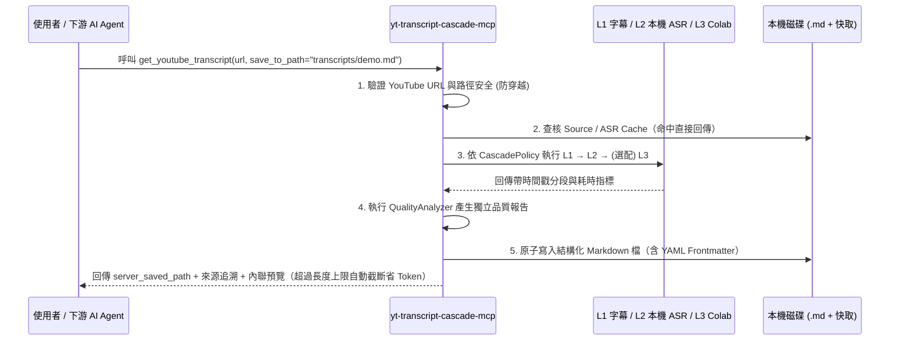
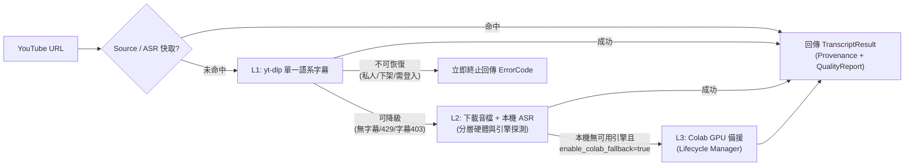

# 🎙️ yt-transcript-cascade-mcp

> **核心目標：如何可靠地取得 YouTube 逐字稿，並自動輸出結構化 Markdown (`.md`) 檔，方便後續 AI Agent 直接調用與人類查看。**
> **零瀏覽器 Cookie、免 YouTube 帳號登入**——透過 **L1 字幕直取 → L2 本機跨硬體離線 ASR → L3 選配雲端 GPU 備援** 三層容災降級架構，並附帶結構化錯誤分類、來源追溯（Provenance）與多維度品質報告。

[](LICENSE)
[](PRD.md)
[](PRD.md)

*(註：本文件目前先提供**繁體中文版**，待 M1–M4 達發布階段將補齊 English / 简体中文 / 日本語 等多語系版本。)*

---

## 🤖 AI Agent 調用與 `.md` 產出處理流程

本專案以 **「AI Agent 一鍵呼叫 → 取得可信 Markdown 逐字稿檔」** 為核心工作流，讓後續的摘要、知識庫（Notion / RAG / Obsidian）、剪輯腳本分析等 Agent 都能直接讀取標準化的 `.md` 檔：



### 產出的 Markdown (`.md`) 結構範例
預設 `output_format="markdown"` 會產出**人機雙讀**的標準 `.md` 檔（可直接丟給其他 Agent 閱讀或手動檢視）：

```markdown
---
video_id: mIg76INLBMU
title: "影片標題"
channel: "頻道名稱"
source_type: LOCAL_ASR          # MANUAL_SUBTITLE | AUTO_SUBTITLE | LOCAL_ASR | CLOUD_ASR
tier_used: L2_LOCAL_ASR
source_language: zh-Hant
quality_status: OK              # OK | WARNING
duration_coverage_ratio: 0.985
---

# 影片標題

- [00:00] 第一段逐字稿內容...
- [00:15] 第二段逐字稿內容...
```

### 雲端授權與上傳前告知
* **`AUTO` 模式**：L1/L2 無須授權；僅於 L2 無法處理且顯式傳入 `enable_colab_fallback=true` 時才進入 L3，並於**音檔上傳前發出 `cloud_upload_notice` 告知**。
* **`COLAB_ONLY` 模式**：強制要求 **`allow_cloud_processing=true`**（未授權即回 `INVALID_INPUT`），同樣於音檔上傳前發出 `cloud_upload_notice`。

---

## 📌 功能成熟度總覽 (Capability Status)

本專案嚴格區分「規劃中」與「已實測驗證」，絕不讓文件宣稱領先於程式碼實際驗證程度：

| 模組 / 能力 | 目標階段 | 當前狀態 | 說明 |
| :--- | :--- | :--- | :--- |
| **MCP 介面 (`FastMCP` Stdio, 4 Tools) + L1 單語字幕** | M1 | `VERIFIED` | 同步執行 + 共用 `deadline`，已通過 12/12 離線測試、Stdio 0-Byte 純淨性與真實 YouTube L1 `.md` 實機驗收 |
| **L2 本機離線 ASR（NVIDIA CUDA / CPU `int8`）** | M2 | `PLANNED` | 分層能力探測 + `openai-whisper` / `faster-whisper` 獨立後端驗證與 `RTF` 量測 |
| **L2 延伸硬體（Apple Silicon MPS）** | M2 | `EXPERIMENTAL` | 視實機 Capability Probe 結果啟用，異常自動退回 CPU `int8` |
| **雙層快取治理 + 跨程序鎖 + 安全閘門 + Benchmark** | M3 | `PLANNED` | 原子寫入、音檔/模型指紋、路徑防穿越與多場景固定音檔基準測試 |
| **L3 Google Colab GPU 備援（macOS / Linux / WSL2）** | M4 | `PLANNED` | 選配 Opt-in，內建 `ColabRuntimeLifecycleManager`（`owner_id` 隔離與啟動恢復） |
| **L3 Google Colab GPU 備援（Windows 原生）** | M4 | `EXPERIMENTAL` | 上游 `google-colab-cli` 官方支援 Linux/macOS，Windows 原生僅列實驗性 |

*(註：AMD ROCm 尚未完成實機驗證，暫不列入正式支援矩陣。)*

---

## 🔄 三層容災降級與 `execution_mode` 流程



### 雲端授權語意分離
* **`AUTO` 模式**：L1 與 L2 無須雲端授權；僅在 L2 無法處理且顯式傳入 `enable_colab_fallback=true` 時，才自動降級 L3。
* **`COLAB_ONLY` 模式**：跳過 L1/L2，仍於本機下載音檔後上傳 Colab；強制要求顯式傳入 **`allow_cloud_processing=true`**（未授權即回傳 `INVALID_INPUT`），並於回應中附帶雲端上傳告知。

---

## 💻 L2 本機硬體與「引擎 × 後端 × 模型」預設策略

本專案不以單一顯卡型號寫死參數，也不提供未驗證的主觀秒數保證；系統先執行分層能力探測，並於實測階段以 **`RTF`（`asr_sec / duration_sec`）** 搭配四段耗時（下載 / 載入 / 轉錄 / 總耗時）呈現效能基準。

| 本機硬體與後端條件 | 支援級別 | 預設引擎與推論精度 | 模型策略 |
| :--- | :--- | :--- | :--- |
| **NVIDIA CUDA（可用 VRAM ≥ 7.5 GB）** | `PLANNED` (M2) | `openai-whisper (PyTorch fp16)` / `faster-whisper (CTranslate2 float16)` | 優先 `turbo`；OOM 依有限序列降級 |
| **NVIDIA CUDA（6–7.5 GB VRAM）** | `PLANNED` (M2) | `faster-whisper (CTranslate2 int8_float16 / int8)` | 探測 `turbo`，失敗降級 `small (int8)` |
| **NVIDIA CUDA（4–6 GB VRAM）** | `PLANNED` (M2) | `faster-whisper (CTranslate2 int8)` | `small`（避開大 VRAM 模型 OOM） |
| **無獨顯 / VRAM < 4 GB（純 CPU）** | `PLANNED` (M2) | `faster-whisper (CTranslate2 cpu int8)` | `small` / `base` |
| **Apple Silicon (`PyTorch MPS`)** | `EXPERIMENTAL` | `openai-whisper (mps)` / `faster-whisper (cpu int8)` | 經探測異常自動退回 CPU `int8` |

---

## 🔒 資料隱私與網路傳輸邊界

本專案採**零瀏覽器 Cookie、免 YouTube 帳號登入**設計，各層級網路與檔案邊界完全透明：
* **L1（字幕直取）**：僅向 YouTube 公開端點請求字幕與影片中繼資料。
* **L2（本機離線 ASR）**：音檔下載與語音辨識**完全在本機執行**，音檔不離開本機。
* **L3（選配 Colab 備援，預設關閉）**：須依模式顯式授權 `enable_colab_fallback=true` 或 `allow_cloud_processing=true` 才會啟用；**音檔會先於本機下載再暫時上傳至您個人帳號的 Google Colab 環境**，完成後立即清除遠端暫存檔並終止由本專案 `owner_id` 建立之 Session（絕不誤關外部 Session；若清理達上限仍失敗將保留 `STOP_FAILED` 紀錄並明確警示）。

---

## ☁️ L3 選配教學：Google Colab GPU 雲端備援（M4 階段）

> ⚠️ **平台支援說明**：上游 `google-colab-cli` 官方支援 **macOS 與 Linux**（Windows 使用者建議透過 **WSL2**；Windows 原生環境僅屬 `EXPERIMENTAL`）。

### 前置條件與資源聲明
1. **Google Colab 算力資格**：需具備可用 GPU 算力之 Google 帳號（例如符合地區資格的 **Google AI Pro** 訂閱或 Colab Pay-As-You-Go / Colab Pro 算力單位 Compute Units）。
2. **動態資源與成本聲明**：L3 依帳號權益與雲端當下可用資源動態分配 GPU；**不保證固定 GPU 型號或固定 Compute Units 費率**。*(特定條件參考：2026-11-22 以 Tesla T4 + PyTorch `openai-whisper turbo` 轉錄 16:32 中文音檔，轉錄約 58 秒、全程約 94 秒、扣減約 `0.02 CU`，僅供參考。)*

### 一次性設定流程（Linux / macOS / WSL2）
1. 安裝官方 `google-colab-cli`（亦可參考 [etrnya/colab-mcp-starter](https://github.com/etrnya/colab-mcp-starter)）：
   ```bash
   pip install git+https://github.com/googlecolab/jupyter-kernel-client.git
   pip install git+https://github.com/googlecolab/google-colab-cli.git
   ```
2. 執行 `colab usage` 完成官方 OAuth 授權（憑證存於系統安全金鑰環，不入設定檔）。
3. 呼叫 `get_youtube_transcript` 時依需求傳入 `enable_colab_fallback=true`（`AUTO` 故障備援）或 `execution_mode="COLAB_ONLY"` + `allow_cloud_processing=true`（主動雲端執行）。

---

## 📚 專案文件導覽

* [PRD.md](PRD.md) — 產品需求規格書 v1.2.2（含完整 14 種 ErrorCode、正式 MCP JSON Schema、39 列需求追溯矩陣與 M0–M4 路線圖）
* [GLOSSARY.md](GLOSSARY.md) — 術語字典與變數命名標準 v1.2.2
* [THIRD_PARTY_NOTICES.md](THIRD_PARTY_NOTICES.md) — 上游依賴、模型權重與外部二進位檔授權完整揭露
* [.agents/AGENTS.md](.agents/AGENTS.md) — AI 協作專規與工程紅線 v1.2.2
* [LICENSE](LICENSE) — Apache License 2.0 授權全文

---

## 🙏 使用與參考之開源專案來源

本專案核心程式碼採用 **Apache License 2.0**；上游依賴、模型權重與外部工具依其原始授權條款使用，完整授權揭露請參閱 **[THIRD_PARTY_NOTICES.md](THIRD_PARTY_NOTICES.md)**：
* [yt-dlp/yt-dlp](https://github.com/yt-dlp/yt-dlp)、[etrnya/YTtomp3](https://github.com/etrnya/YTtomp3)
* [openai/whisper](https://github.com/openai/whisper)、[SYSTRAN/faster-whisper](https://github.com/SYSTRAN/faster-whisper)、[FunAudioLLM/SenseVoice](https://github.com/FunAudioLLM/SenseVoice)
* [googlecolab/google-colab-cli](https://github.com/googlecolab/google-colab-cli)、[etrnya/colab-mcp-starter](https://github.com/etrnya/colab-mcp-starter)
* [modelcontextprotocol/python-sdk](https://github.com/modelcontextprotocol/python-sdk)、[FFmpeg](https://ffmpeg.org/)

---

## 📄 授權條款 (License)

Copyright 2026 `etrnya`

本專案核心程式碼採用 **[Apache License 2.0](LICENSE)** 授權發布。
